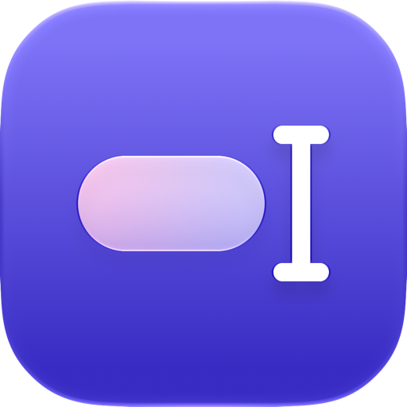

<div align="center">
  <picture>
    <source media="(prefers-color-scheme: dark)" srcset="assets/app-icon-dark.png">
    <source media="(prefers-color-scheme: light)" srcset="assets/app-icon-light.png">
    
  </picture>

  <h1>Gloss</h1>

  <p><strong>Native, on-device selection translation for macOS.</strong></p>

  <p>
    
    
    
    
  </p>

  <p>
    <a href="https://gloss.lorpaves.com">Website</a> · <strong>English</strong> · <a href="README.zh-CN.md">简体中文</a>
  </p>
</div>

---

**Gloss** is a lightweight macOS menu bar app that translates selected text in any application. Select a word, sentence, or paragraph—by dragging, double/triple-clicking, or Shift-clicking—and a quiet floating popup streams the translation right beside your selection without stealing focus.

All translations run **100% locally on your Mac** using a quantized **Hy-MT2-1.8B** model via `HyMTKit`. Gloss goes online only to download the model once (about 1.14 GB) and to check for updates; there are no API keys, and the text you select never leaves your device.

## Install

Download the latest `Gloss-<version>.dmg` from [Releases](https://github.com/lorpaves/gloss/releases/latest), open it and drag Gloss to Applications. Or with Homebrew:

```bash
brew install --cask lorpaves/tap/gloss
```

Gloss requires macOS 15 or later. The app is signed and notarized.

## Features

### On-Device Streaming Translation
- **100% Offline & Private** — Powered by Tencent's `Hy-MT2-1.8B-Q4_K_M.gguf` model, downloaded once and run on the Apple Silicon GPU/CPU via `HyMTKit`.
- **Real-Time Streaming** — Translations stream token-by-token as soon as generation starts.
- **Smart Long-Text Segmentation** — Automatically splits long selections (up to 4,000 characters) by paragraphs and sentences to fit the model's 1,024-token context window without truncation, recursively halving dense segments when needed.

### Reliable Selection Capture
- **Gesture-Aware Filtering** — Recognizes intentional text selections (drag, double/triple-click, Shift-click) while ignoring plain clicks, `⌘`/`⌃` shortcuts, drag-and-drop operations, window moves/resizes, password fields, and UI controls (scroll bars, buttons, menus).
- **Deep Accessibility Integration** — Reads selections and their on-screen bounds directly via the macOS Accessibility API across native Cocoa apps, WebKit views, Electron apps (automatically enabling `AXManualAccessibility`), and Chromium browsers (managing `AXEnhancedUserInterface` and restoring it on quit).
- **Non-Intrusive Clipboard Fallback** — For apps that do not expose selections via Accessibility, Gloss can optionally trigger the app's native **Copy** menu item, capture the copied text, and immediately restore your previous clipboard contents (tagged with `org.nspasteboard.AutoGeneratedType` so clipboard managers ignore it). On macOS 15.4+, the fallback only runs when pasteboard access is set to **Always Allow**, ensuring macOS paste prompts never interrupt your reading.

### Selection-Following Floating Popup
- **Zero Focus Stealing** — Built on a non-activating `NSPanel` with native vibrancy (`NSVisualEffectView` on macOS 15+, Liquid Glass `NSGlassEffectView` on macOS 26+).
- **Smooth Scroll Tracking** — Anchors directly below (or above) the selection, follows scrolling and window movement in real time (with smooth frame interpolation for apps like Chrome that report bounds at lower rates), and hides automatically when the selection scrolls out of view.
- **Compact Typography** — Uses CoreText line-breaking (`FirstLineBreak`) so only the first line indents for the top-right action buttons (**Copy**, **Pin**, **Close**), allowing the rest of the translation to span the full width of the popup.
- **Pin, Drag & Dismiss** — Press `Esc` or click outside to dismiss instantly. Drag the popup or click **Pin** to keep it fixed on screen across app switches and update it in place as you select new text.

### Smart Language Detection & Per-App Control
- **38 Languages Supported** — Translate into any of the 38 languages supported by Hy-MT2, with automatic source language detection across 35 languages via Apple's `NaturalLanguage` framework.
- **Noise & Script Filtering** — Automatically ignores standalone URLs, email addresses, and symbol/number-heavy strings. Disambiguates Kanji-only Chinese from Japanese and skips translation when Simplified/Traditional Chinese text is identical in the target script.
- **Per-App Exclusions** — Quickly toggle translation for the frontmost app directly from the menu bar, or manage excluded apps in Settings (developer tools such as Xcode, Terminal, iTerm2, VS Code, Ghostty, and Rex are excluded by default).
- **Bilingual UI** — Fully localized in **English** and **Simplified Chinese**.

## Supported Languages

Gloss supports translating into all **38 languages** provided by Hy-MT2 (35 of which can also be auto-detected as trigger languages):

> Simplified Chinese, Traditional Chinese, Cantonese*, English, Japanese, Korean, French, German, Spanish, Portuguese, Italian, Russian, Ukrainian, Dutch, Polish, Czech, Turkish, Arabic, Persian, Hebrew, Hindi, Bengali, Marathi, Gujarati, Tamil, Telugu, Urdu, Thai, Vietnamese, Indonesian, Malay, Filipino*, Khmer, Burmese, Tibetan, Kazakh, Mongolian, Uyghur*.
>
> *\*Cantonese, Filipino, and Uyghur are available as target languages; Apple's `NaturalLanguage` framework does not provide source-language identification for them.*

## First Launch

A welcome guide opens at launch until it has been gone through to the end. It walks through the permissions below, each with a button that opens the right page of System Settings (Gloss comes back to the front once a permission is granted), and downloads the translation model.

- **Model download** — The model isn't bundled with the app. Gloss downloads it into `~/Library/Application Support/Gloss/Models` from **Hugging Face** or **ModelScope** (the default in mainland China, where Hugging Face is unreachable). Both serve Tencent's official files; every file is pinned to a revision and checked against its SHA-256 digest. A stopped or failed download resumes where it ended, even after a relaunch.
- **Settings ▸ Model** shows the download, switches the source, reveals the model in Finder, or deletes it.

## Updates

Gloss checks for a new version once a day and installs it through [Sparkle](https://sparkle-project.org). An update found in the background doesn't interrupt you: it waits in the menu bar menu until you open it. **Settings ▸ General** turns the automatic check off, and **Check for Updates…** (there and in the menu) checks right away. Updates are signed; the feed is `https://gloss.lorpaves.com/appcast.xml`.

## Permissions

Gloss runs outside the App Sandbox so it can inspect selections in other applications. It uses two macOS permissions:

1. **Accessibility (Required)** — Used to detect selection gestures, read selected text and screen bounds via `AXUIElement`, and intercept `Esc` while an unpinned popup is visible.
2. **Clipboard Access (Optional, macOS 15.4+)** — Only needed if **Fall Back to Clipboard** is enabled for apps that don't support Accessibility text reading. Set Gloss to **Always Allow** under **System Settings ▸ Privacy & Security ▸ Paste from Other Apps** for seamless fallback without system alerts.

## Building from Source

### Requirements
- **macOS 15.0** (Sequoia) or later
- **Xcode 16.0** or later (Swift 6.0)
- [XcodeGen](https://github.com/yonaskolb/XcodeGen) *(optional, if regenerating `Gloss.xcodeproj` from `project.yml`)*

### Build & Run

Everything needed to build is in this repository: `HyMTKit` is a local Swift package under `Packages/`, and the model is downloaded by the app at first launch.

1. If you modified `project.yml` (or added or removed files), regenerate the Xcode project:
   ```bash
   xcodegen generate
   ```
2. Open `Gloss.xcodeproj` in Xcode and build & run the **Gloss** scheme (`⌘R`), or build from the terminal:
   ```bash
   xcodebuild -project Gloss.xcodeproj -scheme Gloss -configuration Release build
   ```
3. Run the unit test suite:
   ```bash
   xcodebuild -project Gloss.xcodeproj -scheme Gloss test
   ```

## Project Structure

```text
Gloss/
├── Gloss/
│   ├── App/            # App entry point, AppDelegate composition root, and AppCoordinator
│   ├── Selection/      # Mouse/scroll event monitoring, gesture classification, AX reader & copy fallback
│   ├── Language/       # NaturalLanguage detection, script checks, and trigger evaluation rules
│   ├── Translation/    # TranslationEngine actor, TextSegmenter, and the model's download (ModelManager, ModelDownloader)
│   ├── Popup/          # Non-activating NSPanel, SwiftUI content view, CoreText first-line splitter & Esc tap
│   ├── MenuBar/        # MenuBarExtra content view and template icon
│   ├── Onboarding/     # First-launch welcome guide: permissions and model download
│   ├── Settings/       # User preferences model, UserDefaults store, LoginItem service, and the tabbed Settings window
│   ├── Permission/     # Accessibility trust and macOS 15.4+ pasteboard permission monitors
│   ├── Update/         # AppUpdater: Sparkle update checks, shown quietly in the menu
│   └── Resources/      # String catalog (Localizable.xcstrings), Info.plist (update feed and key), and Icon Composer bundle (AppIcon.icon)
├── GlossTests/         # Unit tests: gestures, geometry, language detection, layout, segmentation, model download, onboarding
├── Packages/HyMTKit/   # Local Swift package: llama.cpp-based Hy-MT2 translator
├── assets/             # README media assets
└── project.yml         # XcodeGen project specification
```

## License

Copyright (C) 2026 Lorpaves

Gloss is free software: you can redistribute it and/or modify it under the terms of the [GNU General Public License v3.0](LICENSE) as published by the Free Software Foundation. Modified versions you distribute must be released under the same license. Gloss comes with ABSOLUTELY NO WARRANTY; see the license for details.

The translation model is not part of this repository: Gloss downloads Tencent's Hy-MT2 at first launch, which Tencent licenses under the Apache License 2.0. Updates are handled by [Sparkle](https://github.com/sparkle-project/Sparkle), which is MIT-licensed.
