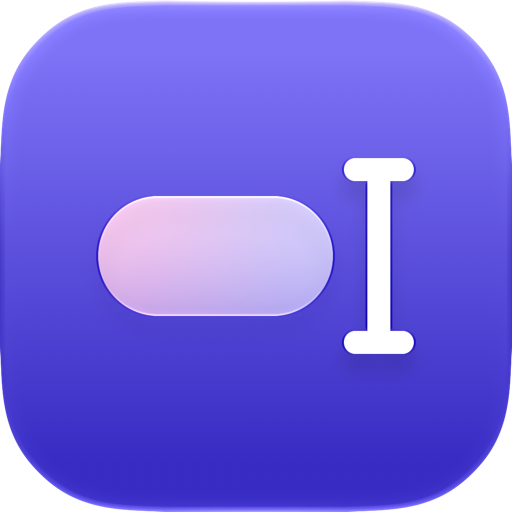

<div align="center">
  <picture>
    <source media="(prefers-color-scheme: dark)" srcset="assets/app-icon-dark.png">
    <source media="(prefers-color-scheme: light)" srcset="assets/app-icon-light.png">
    
  </picture>

  <h1>Gloss</h1>

  <p><strong>原生、纯本地运行的 macOS 划词翻译工具。</strong></p>

  <p>
    
    
    
    
  </p>

  <p>
    <a href="https://gloss.lorpaves.com">官网</a> · <a href="README.md">English</a> · <strong>简体中文</strong>
  </p>
</div>

---

**Gloss** 是一款轻量、克制的 macOS 菜单栏划词翻译应用。在任意应用中通过拖拽、双击/三击、Shift 点击，或用键盘（`⌘A`、Shift + 方向键）选中文本，Gloss 即可在选区旁弹出轻巧的悬浮气泡，实时流式呈现译文，全程不抢占当前窗口焦点。

所有翻译均通过 **Hy-MT2-1.8B** 量化模型（基于 `HyMTKit`）在 **Mac 本地 100% 离线完成**——只有首次下载模型（约 1.14 GB）和检查更新时才会联网，无需配置 API Key，你选中的文字不会离开你的设备。

## 安装

从 [Releases](https://github.com/lorpaves/gloss/releases/latest) 下载最新的 `Gloss-<版本>.dmg`，打开后把 Gloss 拖进「应用程序」。也可以用 Homebrew：

```bash
brew install --cask lorpaves/tap/gloss
```

Gloss 需要 macOS 15 或更高版本。App 已签名并通过 Apple 公证。

## 功能特性

### 纯本地流式翻译
- **100% 离线与隐私保护** — 使用腾讯 `Hy-MT2-1.8B-Q4_K_M.gguf` 翻译模型，只需下载一次，通过 `HyMTKit` 在 Apple Silicon GPU/CPU 上本地推理。
- **实时流式输出** — 译文生成后逐词流式呈现在气泡中，无需等待整段翻译完成。
- **长文本智能切分** — 自动按段落与句子边界切分长文本，适配模型 1,024 Token 上下文窗口而不截断译文；遇到高密度超长句时自动折半递归翻译。

### 精准无感的划词捕获
- **手势智能识别** — 精准识别真正的选词操作（拖拽选词、双击选词、三击选段、Shift 扩选，以及键盘的 `⌘A` 全选和 Shift + 方向键），自动忽略普通单击、`⌘`/`⌃` 快捷键点击、文件拖拽、窗口移动/缩放、密码输入框以及滚动条/按钮/菜单等控件交互。
- **深度辅助功能（Accessibility）集成** — 优先通过 macOS Accessibility API 直接读取选区文本及屏幕坐标，原生支持 Cocoa 应用、WebKit 视图、Electron 应用（自动开启 `AXManualAccessibility`）以及 Chromium 内核浏览器（按需开启 `AXEnhancedUserInterface` 并在退出时自动还原）。
- **无打扰剪贴板取词回退** — 当目标应用未通过辅助功能暴露选区时，Gloss 可按需触发应用菜单栏的原生「拷贝」菜单项读取文本，并在瞬间完整还原原有剪贴板快照（自动标记 `org.nspasteboard.AutoGeneratedType`，避免污染剪贴板历史工具）。在 macOS 15.4+ 上仅在剪贴板权限设为「始终允许」时启用回退，绝不弹出系统粘贴确认框打断阅读。

### 跟随选区的悬浮气泡
- **不抢占键盘焦点** — 基于非激活式 `NSPanel` 构建，采用 macOS 原生毛玻璃材质（macOS 15+ 使用 `NSVisualEffectView`，macOS 26+ 自动启用 Liquid Glass `NSGlassEffectView`）。
- **平滑跟随滚动** — 气泡精准锚定在选区正下方（或正上方），随页面滚动与窗口移动实时跟随（针对 Chrome 等低频上报位置的应用内置平滑插值过渡），并在选区滚出可视区域时自动隐藏。
- **紧凑排版设计** — 利用 CoreText 排版测算（`FirstLineBreak`）仅在译文首行右侧为「复制」「固定」「关闭」按钮预留空间，其余行完整铺满气泡宽度。
- **固定、拖拽与快捷关闭** — 按下 `Esc`（仅在未固定气泡显示时拦截，不传透至底层应用）或点击外部区域即可关闭；拖拽气泡或点击「固定（Pin）」可将气泡固定在屏幕上，跨应用或切换桌面空间时保持常驻，并在每次划选新词时原地更新译文。

### 智能语种检测与按应用控制
- **支持 38 种语言** — 支持翻译为 Hy-MT2 涵盖的全部 38 种语言，并基于 Apple `NaturalLanguage` 框架自动识别其中 35 种源语言。
- **噪声过滤与简繁甄别** — 自动忽略纯链接（URL/邮箱）及符号/数字占比过高的非自然语言文本；自动区分纯汉字中文与日文（不含假名时归为中文），并在简繁中文字符完全一致时跳过冗余翻译。
- **应用黑白名单管理** — 可直接从菜单栏一键在当前应用中停用/启用划词翻译，或在设置中管理「不翻译的 App」（默认排除 Xcode、Terminal、iTerm2、VS Code、Ghostty、Rex 等开发工具）。
- **双语界面** — 完整支持**简体中文**与**英文**界面本地化。

## 支持语言

Gloss 支持将选区翻译为以下 **38 种语言**（其中 35 种支持作为自动识别的触发源语言）：

> 简体中文、繁体中文、粤语*、英语、日语、韩语、法语、德语、西班牙语、葡萄牙语、意大利语、俄语、乌克兰语、荷兰语、波兰语、捷克语、土耳其语、阿拉伯语、波斯语、希伯来语、印地语、孟加拉语、马拉地语、古吉拉特语、泰米尔语、泰卢固语、乌尔都语、泰语、越南语、印尼语、马来语、菲律宾语*、高棉语、缅甸语、藏语、哈萨克语、蒙古语、维吾尔语*。
>
> *\*注：粤语、菲律宾语与维吾尔语可作为目标翻译语言；由于 Apple `NaturalLanguage` 框架暂不支持识别这三种语言，它们不会出现在源语言自动触发列表中。*

## 首次启动

首次启动时会打开欢迎引导（没走完的话，下次启动会再次打开）：逐项说明下面的权限，每项都有按钮直接打开系统设置中对应的页面（权限开启后 Gloss 会自动回到前台），并下载翻译模型。

- **模型下载** — 模型不随 App 打包。Gloss 会把它下载到 `~/Library/Application Support/Gloss/Models`，下载源可选 **Hugging Face** 或 **ModelScope（魔搭社区）**（中国大陆默认使用 ModelScope，因为访问不了 Hugging Face）。两者提供的都是腾讯官方文件，每个文件都固定到具体版本并校验 SHA-256；下载中断或失败后会从断点继续，重新启动 App 也一样。
- **设置 ▸ 模型** 中可以查看下载进度、切换下载源、在访达中显示或删除模型。

## 更新

Gloss 每天检查一次新版本，并通过 [Sparkle](https://sparkle-project.org) 安装。后台发现的更新不会打断你：它会在菜单栏菜单里等着，直到你点开。**设置 ▸ 通用** 里可以关闭自动检查，「**检查更新…**」（设置和菜单里都有）会立即检查。更新包带有签名，更新源是 `https://gloss.lorpaves.com/appcast.xml`。

## 权限说明

为了跨应用读取选区，Gloss 运行在 App Sandbox 之外，并使用以下两项系统权限：

1. **辅助功能（Accessibility，必需）** — 用于监听选词手势（鼠标按键，以及用来选中文本的按键；不保存也不记录你输入的任何内容）、通过 `AXUIElement` 读取选中文本与屏幕坐标，以及在气泡显示时响应 `Esc` 键关闭。
2. **剪贴板读取（Clipboard Access，可选，macOS 15.4+）** — 仅在开启「无法直接取词时改用剪贴板」以兼容不支持辅助功能取词的应用时需要。请在 **系统设置 ▸ 隐私与安全性 ▸ 从其他 App 粘贴** 中将 Gloss 设为「**始终允许**」，即可实现无弹窗静默取词。

## 从源码构建

### 环境要求
- **macOS 15.0** (Sequoia) 及以上
- **Xcode 16.0** 及以上（Swift 6.0）
- [XcodeGen](https://github.com/yonaskolb/XcodeGen) *（可选，修改 `project.yml` 后用于重新生成 `Gloss.xcodeproj`）*

### 编译与运行

编译所需的一切都在本仓库中：`HyMTKit` 是 `Packages/` 下的本地 Swift Package，模型由 App 在首次启动时下载。

1. 如修改了 `project.yml`（或增删了文件），使用 XcodeGen 重新生成工程：
   ```bash
   xcodegen generate
   ```
2. 使用 Xcode 打开 `Gloss.xcodeproj` 并运行 **Gloss** Scheme（`⌘R`），或在终端中编译：
   ```bash
   xcodebuild -project Gloss.xcodeproj -scheme Gloss -configuration Release build
   ```
3. 运行单元测试：
   ```bash
   xcodebuild -project Gloss.xcodeproj -scheme Gloss test
   ```

## 项目结构

```text
Gloss/
├── Gloss/
│   ├── App/            # 应用入口、AppDelegate 依赖组装根（无单例）与 AppCoordinator 核心协调器
│   ├── Selection/      # 鼠标/滚轮/键盘全局监听、手势分类、AccessibilityReader 与剪贴板回退取词
│   ├── Language/       # NaturalLanguage 语种识别、字符集甄别与触发规则评估
│   ├── Translation/    # TranslationEngine 翻译引擎 Actor、TextSegmenter 与模型下载（ModelManager、ModelDownloader）
│   ├── Popup/          # 非激活式 NSPanel、SwiftUI 气泡视图、CoreText 首行折行测算与 Esc 拦截器
│   ├── MenuBar/        # MenuBarExtra 菜单栏视图与状态栏图标
│   ├── Onboarding/     # 首次启动欢迎引导：权限与模型下载
│   ├── Settings/       # 用户偏好模型、UserDefaults 持久化、开机自启服务与分页设置窗口
│   ├── Permission/     # 辅助功能信任状态与 macOS 15.4+ 剪贴板读取权限管理
│   ├── Update/         # AppUpdater：基于 Sparkle 的更新检查，在菜单里安静提示
│   └── Resources/      # 多语言字符串目录 (Localizable.xcstrings)、Info.plist（更新源与公钥）与应用图标 (AppIcon.icon)
├── GlossTests/         # 单元测试：手势分类、几何坐标、语种检测、气泡布局、长文本切分、模型下载与欢迎引导
├── Packages/HyMTKit/   # 本地 Swift Package：基于 llama.cpp 的 Hy-MT2 翻译器
├── assets/             # README 展示图片资源
└── project.yml         # XcodeGen 工程配置文件
```

## 开源协议

Copyright (C) 2026 Lorpaves

本项目基于 [GNU 通用公共许可证第 3 版（GPL-3.0）](LICENSE) 开源：你可以按照该协议自由地再分发和修改本项目，但分发修改后的版本时，同样必须以 GPL-3.0 公开源码。本项目不提供任何担保，详见协议全文。

翻译模型不包含在本仓库中：Gloss 会在首次启动时下载腾讯的 Hy-MT2 模型，该模型由腾讯以 Apache License 2.0 授权。更新功能使用以 MIT 协议授权的 [Sparkle](https://github.com/sparkle-project/Sparkle)。
